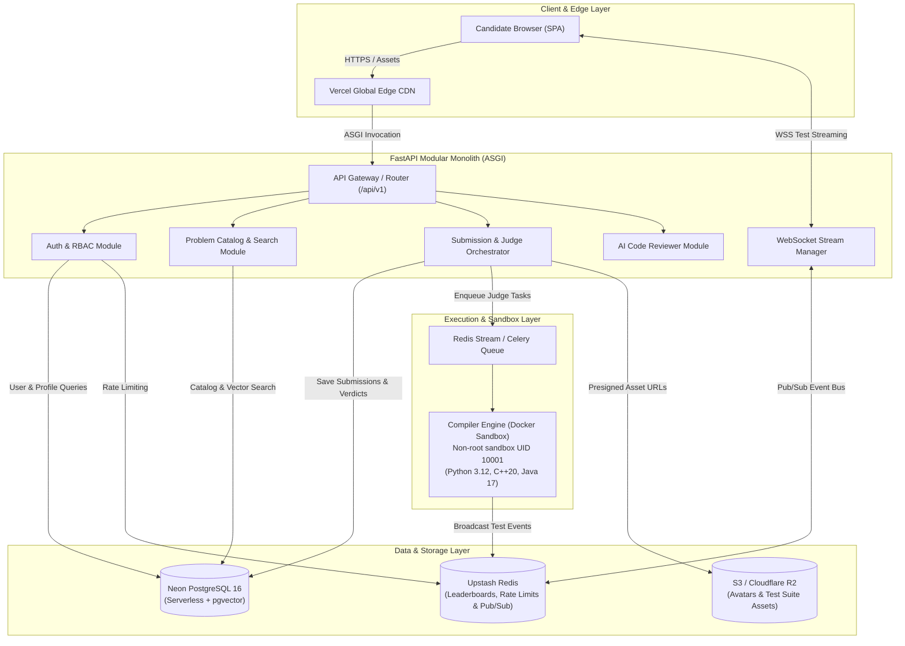
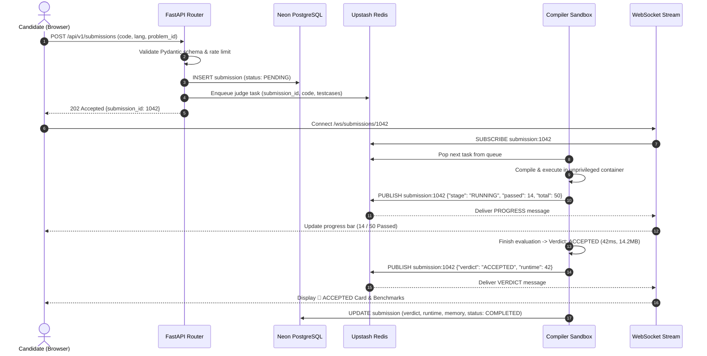
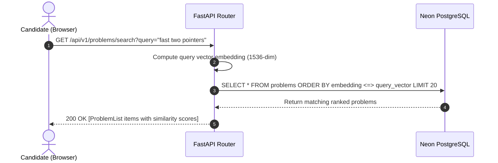

# Code Captain: System Architecture Specification (Layer 2)

**Product Name:** Code Captain Online Judge  
**Document Version:** 1.0.0  
**Phase:** 2 — System Architecture (Plan Phase)  
**Status:** Approved Baseline  
**Related Documents:** [docs/system-design.md](system-design.md), [docs/decisions/0001-modular-monolith.md](decisions/0001-modular-monolith.md)

---

## 1. High-Level Component Architecture

Code Captain is architected as an **async modular monolith** on FastAPI, coupled with a serverless data layer and an out-of-process isolated compiler execution sandbox.

---

## 2. Component Responsibilities

### 1. Frontend Single-Page Application (`frontend/index.html`)
* **Role:** High-performance, low-latency candidate interface.
* **Responsibilities:**
  - Manages view transitions between Problem Hub, Coding Arena, Leaderboards, and Profiles without full-page reloads.
  - Hosts CodeMirror 5 editor with custom themes, persistent `localStorage` draft saving, font scaling, and keyboard shortcuts (`Ctrl+Enter`, `Ctrl+'`).
  - Connects to `/ws/submissions/{id}` to stream animated progress bars, live test case counters, and side-by-side Wrong Answer diffs.

### 2. API Gateway & Routing (`app/api/v1/router.py`)
* **Role:** Entrypoint and request pipeline for all HTTP requests.
* **Responsibilities:**
  - Enforces strict Pydantic v2 input schema validation.
  - Verifies JWT access tokens and attaches authenticated `User` context to request dependencies.
  - Standardizes JSON error envelopes (`{"error": {"code": ..., "message": ...}}`).
  - Sets security headers and validates CORS origins against authorized domains.

### 3. Submission & Judge Orchestrator (`app/api/v1/submissions.py`, `app/services/sandbox.py`)
* **Role:** Oversees the evaluation lifecycle of user code.
* **Responsibilities:**
  - Validates submission payload, verifies problem availability, and checks user rate quotas.
  - Persists initial `PENDING` submission record to PostgreSQL with client idempotency check.
  - Dispatches execution tasks to the judge queue with problem test cases.
  - Records final verdict, execution runtime (ms), memory footprint (MB), and score.

### 4. Compiler Engine Sandbox (`compiler-engine/Dockerfile`, `compiler-engine/index.js`)
* **Role:** Isolated, untrusted code execution environment.
* **Responsibilities:**
  - Runs in a dedicated Docker container under an unprivileged `sandbox` user (`UID 10001`).
  - Compiles and runs Python 3.12, C++20 (GCC), and Java 17 (OpenJDK) programs against test case stdin.
  - Enforces OS-level CPU time limits ($1.0$s – $2.0$s) and memory quotas ($256$ MB).
  - Emits real-time progress events (`PROGRESS`, `STAGE`, `VERDICT`) over Redis Pub/Sub back to the WebSocket stream.

### 5. Redis Real-Time & Caching Layer (`app/core/redis.py`)
* **Role:** High-throughput cache, leaderboard engine, and event broker.
* **Responsibilities:**
  - Maintains sorted set (`ZADD`, `ZREVRANGE`) leaderboards for real-time rank lookups.
  - Tracks sliding-window rate limiting counters per IP and per user account.
  - Acts as the Pub/Sub broker coupling asynchronous judge execution with WebSocket connections.

### 6. Neon PostgreSQL with pgvector (`app/core/database.py`)
* **Role:** Authoritative ACID relational data store.
* **Responsibilities:**
  - Stores users, profiles, problems, test cases, submissions, and contest rosters.
  - Executes semantic similarity queries using `pgvector` $1536$-dimensional embeddings for natural language problem discovery.

---

## 3. Core User Journey Data Flows

### Journey 1: Code Submission & Real-time Test Evaluation

---

### Journey 2: Semantic Problem Discovery (`pgvector`)

---

## 4. Synchronous vs Asynchronous Boundary

To prevent serverless function timeouts and HTTP request blocking, system responsibilities are strictly partitioned:

| Operation | Execution Model | Rationale |
|---|:---:|---|
| **User Authentication & Signup** | **Synchronous (HTTP)** | Must verify credentials and issue JWT immediately before allowing access. |
| **Problem Catalog Retrieval & Pagination** | **Synchronous (HTTP + Cache)** | Sub-50ms read path; cached in Redis. |
| **Code Submission Enqueueing** | **Synchronous (HTTP)** | Immediately validates syntax/rate limit, creates DB record, and returns `submission_id`. |
| **Compilation & Multi-Test Execution** | **Asynchronous (Worker)** | Can take 500ms to 5,000ms. Must never block HTTP worker threads. |
| **Test Case Progress Streaming** | **Asynchronous (WebSocket)** | Real-time events pushed to client as tests complete without polling. |
| **AI Mentor Complexity Analysis** | **Asynchronous (Background)** | LLM inference takes 1–3s; runs in background and notifies user when ready. |
| **Contest Leaderboard Updates** | **Asynchronous (Pub/Sub)** | Evaluated submission immediately updates Redis sorted set in background. |

---

## 5. External Dependency Failure & Graceful Degradation Matrix

| Dependency | Impact if Down | Failure Detection | Graceful Degradation Policy |
|---|---|:---:|---|
| **Neon PostgreSQL** | Cannot read/write persistent data. | `/health` DB ping fails; DB connection pool timeout. | Frontend displays **"Database Maintenance"** banner. Active coding arena sessions continue locally with cached problems and `localStorage` drafts. |
| **Upstash Redis** | Live leaderboards, rate limits, and WebSocket streaming fail. | `/health` Redis ping fails. | Platform falls back to polling `GET /api/v1/submissions/{id}` directly against PostgreSQL every 2s for verdicts. |
| **Compiler Sandbox Engine** | Submissions cannot be compiled or judged. | Queue depth exceeds threshold; health probe failure. | Submissions remain in `PENDING` state in queue. UI warns: *"Judge is experiencing high load; submissions are queued and will process shortly."* No submissions are dropped. |
| **S3 / Cloudflare R2** | Cannot upload or view custom candidate avatars. | Presigned URL generation throws exception. | Avatar upload button shows temporary error; UI falls back gracefully to default initials/identicon SVG. |

---

## 6. Layer 2 Verification Checklist

- [x] Component diagram accurately reflects the full stack (Client, CDN, API Gateway, Redis, DB, Sandbox).
- [x] Every long-running task (judge compilation, test execution) is asynchronous and decoupled from HTTP requests.
- [x] Clear boundaries exist between modules (Auth, Problems, Submissions, Leaderboard, AI).
- [x] Third-party failures have deterministic graceful degradation paths documented.
