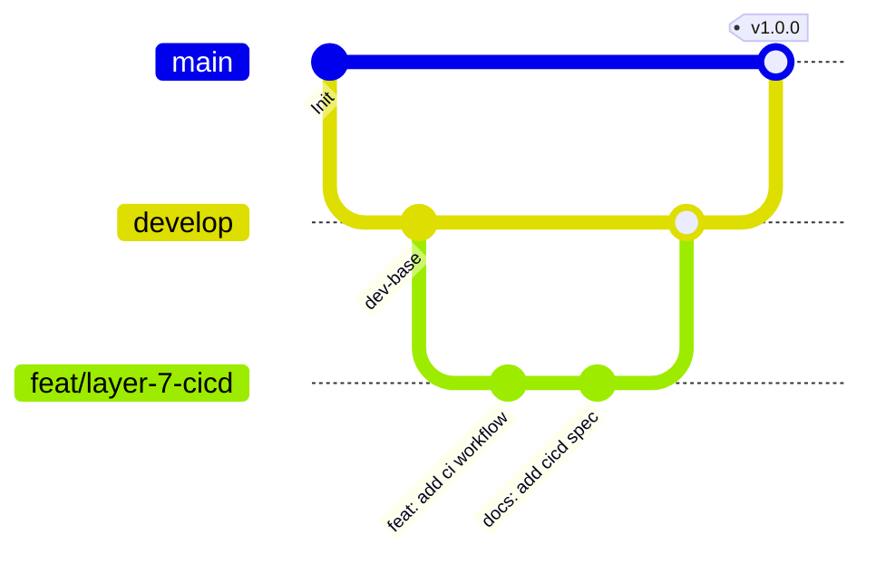
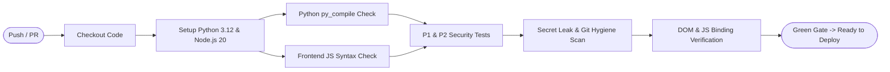

# Layer 7: CI/CD & Version Control Specification

## 1. Executive Summary

Code Captain implements an automated Continuous Integration and Continuous Deployment (CI/CD) pipeline guaranteeing that zero broken builds, syntax regressions, security vulnerabilities, or hardcoded secrets enter production. 

- **Code Repository**: GitHub (`Spyder2024/Online-judge`)
- **CI Runner**: GitHub Actions (`.github/workflows/ci.yml`) on `ubuntu-latest`
- **CD Target**: Vercel Serverless Platform with automated Git hook deployments
- **Target URL**: `https://online-judge-iota-ashen.vercel.app`

---

## 2. Git Branching & Merge Strategy



| Branch Type | Name Pattern | Purpose | Deployment Target |
| :--- | :--- | :--- | :--- |
| **Production** | `main` | Production-ready, stable codebase | Production (`https://online-judge-iota-ashen.vercel.app`) |
| **Development** | `develop` | Integration branch for upcoming releases | Staging / Preview Environment |
| **Feature** | `feat/<feature-name>` | Scoped feature implementation | Ephemeral Preview Deployment |
| **Bugfix** | `fix/<bug-description>` | Targeted bug resolution | Ephemeral Preview Deployment |
| **Hotfix** | `hotfix/<patch-name>` | Critical production remediation | Direct to `main` with approval |

---

## 3. Conventional Commit Standard

All commits must adhere to the Conventional Commits 1.0.0 specification:

```text
<type>(<scope>): <short imperative description>

[optional body describing the architectural context or problem resolved]

[optional footer(s) such as Closes #123 or BREAKING CHANGE: ...]
```

### Approved Types
- `feat`: A new feature or capability introduced to candidate or judge flows.
- `fix`: A bug fix or remediation of a runtime defect.
- `docs`: Documentation modifications only (e.g. `docs/*.md`, architectural diagrams).
- `chore`: Maintenance tasks, configuration adjustments, or dependency cleanups.
- `refactor`: Code changes that neither fix a bug nor add a feature.
- `test`: Adding or correcting automated tests, smoke assertions, or fixtures.

---

## 4. Automated CI Workflow Pipeline (`.github/workflows/ci.yml`)

The pipeline executes automatically on every `push` to `main` and all `pull_request` triggers targeting `main`:



1. **Python Bytecode Compilation**:
   Runs `python -m py_compile` across `main.py`, `app/**/*.py`, and `scripts/*.py` to detect any syntax or indentation errors.
2. **JavaScript Syntax Verification**:
   Extracts all `<script>` tags from `frontend/index.html` and evaluates them using `node -c` to prevent client-side JS syntax crashes.
3. **P1 & P2 Security Remediation Tests**:
   Executes `scripts/test_p1_remediation.py` and `scripts/test_p2_remediation.py` to assert CSRF OAuth token signatures, presigned storage access boundaries, production secret key validation, and XSS sanitization.
4. **Secret Leak & Hygiene Scan**:
   Verifies that no `.env` files or unauthorized credential files exist in the repository tree.
5. **DOM Contract & Function Binding Sanity**:
   Asserts the presence of all required DOM elements (`#screen-hub`, `#screen-arena`, `#network-status-banner`, etc.) and critical runtime functions (`submitCodeToArena`, `fetchProblems`).

---

## 5. Deployment Pipeline (Continuous Delivery)

1. **Vercel GitHub Integration**:
   - Commits pushed to `main` automatically trigger a production build on Vercel.
   - Vercel builds `api/index.py` via `@vercel/python` and serves `frontend/**` via `@vercel/static`.
2. **Environment Variable Segregation**:
   - Production secrets (`DATABASE_URL`, `SECRET_KEY`, `GOOGLE_CLIENT_ID`, `GOOGLE_CLIENT_SECRET`, `UPSTASH_REDIS_REST_URL`) reside strictly within the Vercel Project Settings dashboard.
   - Developers configure `.env` locally using `.env.example` as the canonical template.
