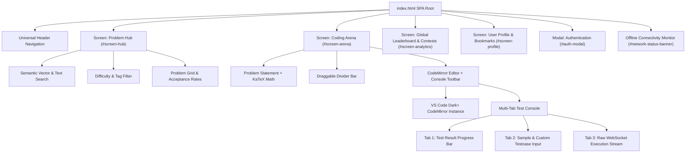

# Layer 6: Frontend Architecture & Client Reliability

## 1. Executive Summary & Design System

Code Captain's frontend is a zero-build Single-Page Application (SPA) designed for sub-100ms transitions, real-time code execution streaming, and distraction-free developer experience. It adheres to an unyielding high-contrast dark palette (`#0B0F14` void background, `#1A2233` card surface, `#E6C38A` warm gold accents) with typography calibrated for algorithmic problem solving.

| Semantic Token | Color Code | Purpose |
| :--- | :--- | :--- |
| **Background Dark** | `#0B0F14` | Void backdrop across all screens |
| **Card Surface** | `#131922` | Split-panes, data tables, problem descriptions |
| **Elevated Surface** | `#1A2233` | Modals, active tab pills, floating toolbars |
| **Primary Accent** | `#E6C38A` | Interactive CTA buttons, active tabs, ranking badges |
| **Border Neutral** | `#222D3D` | Pane dividers, table row outlines, input borders |
| **Text Primary** | `#F1F5F9` | Problem statements, editor text, user names |
| **Text Secondary** | `#94A3B8` | Metadata, tags, subtext, timestamp labels |
| **Verdict Accepted** | `#10B981` | Green status badge, passed testcases |
| **Verdict Rejected** | `#EF4444` | Red status badge, WA / TLE / RE testcases |

---

## 2. Core SPA Screen Hierarchy

---

## 3. Client-Side State Management & Persistence

The platform manages state synchronously without third-party framework overhead, ensuring zero memory leaks during hours-long coding contests:

1. **Authentication State**:
   - `localStorage.getItem('access_token')`: Standard JWT bearer token attached to API requests.
   - `localStorage.getItem('username')`: Current user handle for profile and navigation display.
2. **Code Draft Persistence**:
   - Every keystroke in the CodeMirror editor autosaves to `localStorage.setItem('draft_${problem_id}_${language}', code)`.
   - On problem selection or language switch, the editor automatically restores the candidate's latest draft, preventing work loss on browser refreshes or accidental navigation.
3. **Problem Cache**:
   - `cachedProblems`: In-memory array of problem records fetched from `GET /api/v1/problems`, with instant fallback to built-in fallback fixtures if offline.

---

## 4. Edge-Case Hardening & Reliability Features

### A. Offline Connectivity Detection
- Real-time listeners on `window.addEventListener('offline')` and `window.addEventListener('online')`.
- Displays a top fixed notification banner informing the candidate when the network drops:
  - **Offline State**: Alerts that submissions will pause while local code drafts remain safely saved.
  - **Online State**: Surfaces green confirmation badge for 3.5 seconds before auto-dismissal.

### B. Input Validation Floor
- **Empty Code Submission Prevention**: Submissions with empty or whitespace-only code are blocked client-side with a clear validation error badge, avoiding wasted server execution cycles.
- **Argon2 Password Length Validation**: Enforces minimum 8-character passwords with real-time helper text.

### C. Interactive Custom Testcase Console
- The **Testcase Tab** allows toggling between built-in sample cases (Case 1, Case 2, Case 3) and a **+ Custom** input mode.
- In **+ Custom** mode, an editable monospace textarea allows candidates to provide arbitrary input parameters and verify execution during local pre-flight runs (`Ctrl + '`).

---

## 5. Security & Secret Verification

- **Zero Client Secrets**:
  - Code inspection confirms zero hardcoded API keys, private credentials, or internal server passwords in `frontend/index.html`.
  - All communication is routed through public endpoints (`/api/v1/*`) secured by standard HTTP Bearer tokens and signed OAuth state CSRF parameters.
- **XSS & Injection Protection**:
  - `escapeHtml()` sanitization wraps all user-provided strings and dynamic server error messages before DOM insertion.
