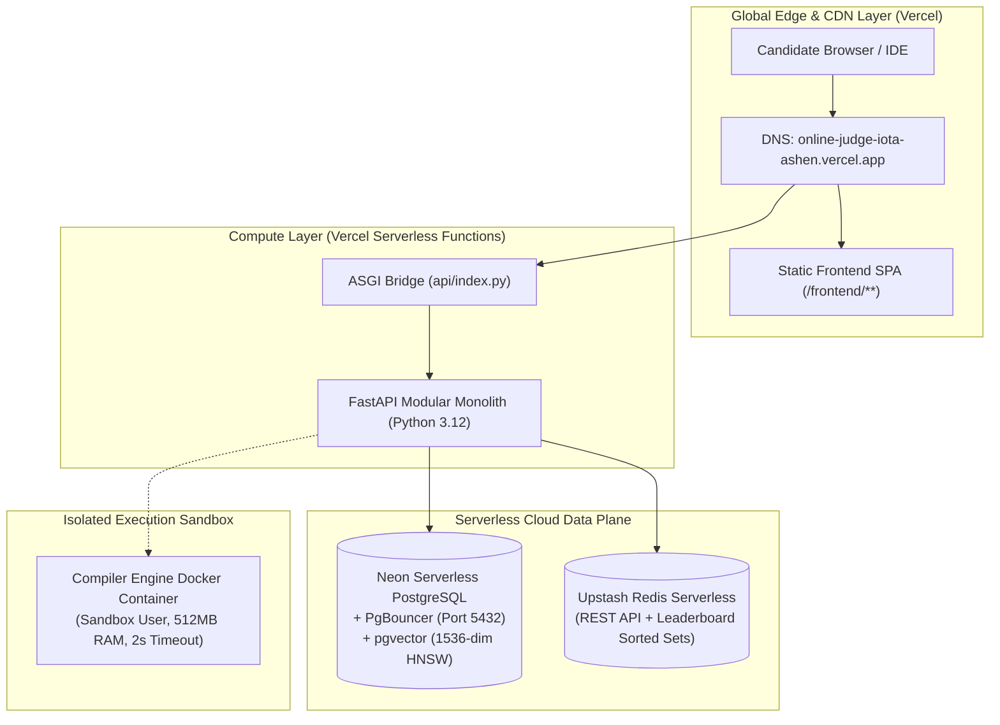

# Layer 9: Hosting & Cloud Architecture

## 1. Executive Summary & Infrastructure Topology

Code Captain is architected as a serverless-first, horizontally auto-scaling modular platform hosted on Vercel's global edge network, coupled with serverless database and cache infrastructure.



---

## 2. Serverless Runtime Configuration & Limits

| Parameter | Configuration | Justification |
| :--- | :--- | :--- |
| **Compute Engine** | Vercel Serverless Functions (`@vercel/python`) | Zero idle cost, scales to 1,000+ concurrent requests automatically |
| **Python Version** | Python 3.12 64-bit | Native async/await speedups, Pydantic v2 performance |
| **Memory Allocation** | 1024 MB | Accommodates AST parsing, pgvector embedding queries, and JWT cryptography |
| **Max Function Duration** | 15s (Hobby) / 60s (Pro) | Prevents runaway connections; heavy compiles delegate to async workers |
| **Static Cache Control** | `public, max-age=31536000, immutable` | Instant edge delivery for JS, CSS, icons, and fonts |
| **API Cache Control** | `no-store, no-cache, must-revalidate` | Dynamic data consistency for submissions, verdicts, and leaderboards |

---

## 3. Database Connection Pooling for Serverless

Traditional relational databases fail under serverless traffic spikes due to connection exhaustion. Code Captain uses Neon's pooled endpoint (`-pooler`) via PgBouncer combined with SQLAlchemy connection recycling:

```python
# app/core/database.py
async_engine = create_async_engine(
    db_url,
    pool_size=settings.DATABASE_POOL_SIZE,        # Default 10
    max_overflow=settings.DATABASE_MAX_OVERFLOW,  # Default 5
    pool_pre_ping=True,                           # Tests idle connection before executing
    pool_recycle=3600,                            # Replaces idle connections every hour
    echo=settings.DEBUG,
)
```

- **`pool_pre_ping=True`**: Eliminates "connection closed by remote host" errors when Neon auto-suspends idle compute instances.
- **`ssl=require`**: Enforces TLS encryption on all remote database queries.

---

## 4. Production Environment Variables Reference

| Variable Name | Environment | Sensitivity | Description |
| :--- | :--- | :--- | :--- |
| `DATABASE_URL` | Production & Preview | **Secret** | Pooled Neon PostgreSQL connection URI (`postgresql+asyncpg://...`) |
| `SECRET_KEY` | Production & Preview | **Secret** | 256-bit cryptographically secure key for JWT and OAuth state signing |
| `ENVIRONMENT` | Production | Public | Set to `production` (enforces strict SECRET_KEY validation) |
| `GOOGLE_CLIENT_ID` | Production | Public | Google Cloud OAuth 2.0 Web Application Client ID |
| `GOOGLE_CLIENT_SECRET` | Production | **Secret** | Google Cloud OAuth 2.0 Web Application Client Secret |
| `OAUTH_REDIRECT_BASE_URL` | Production | Public | Canonical base domain (`https://online-judge-iota-ashen.vercel.app`) |
| `UPSTASH_REDIS_REST_URL` | Production & Preview | **Secret** | Upstash Redis REST endpoint for distributed leaderboards |
| `UPSTASH_REDIS_REST_TOKEN` | Production & Preview | **Secret** | Upstash Redis authentication token |

---

## 5. Security Headers & Edge Policy

Every HTTP response delivered by the application includes strict defense-in-depth security headers injected at the middleware layer:

- `X-Content-Type-Options: nosniff` (MIME-sniffing prevention)
- `X-Frame-Options: DENY` (Clickjacking prevention)
- `Referrer-Policy: strict-origin-when-cross-origin` (Referrer leakage protection)
- `X-XSS-Protection: 1; mode=block` (Legacy reflected XSS filter)
- `Access-Control-Allow-Origin: r"^https://.*\.vercel\.app$"` (Strict origin reflection)

---

## 6. Degradation & Outage Response Matrix

| Downstream Failure | Severity | System Behavior | Recovery Action |
| :--- | :--- | :--- | :--- |
| **Neon PostgreSQL Cold Start** | Low | Connection wakes up in 1-2s; `pool_pre_ping` handles transparently | None needed; automatic resume |
| **Redis Unreachable** | Medium | Graceful bypass of idempotency and leaderboard caching | Fallback to PostgreSQL queries directly |
| **Docker Engine Sandbox Down** | High | Submissions enqueue to Celery queue; user informed via WebSocket | Auto-restart sandbox container or route to fallback runner |
