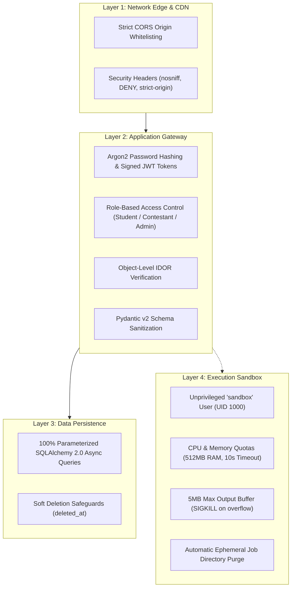

# Layer 10: Security Architecture & Threat Model

## 1. Executive Summary & Defense-in-Depth Posture

Code Captain adopts an unyielding defense-in-depth posture engineered specifically for multi-tenant code execution platforms. Because candidates intentionally submit untrusted, arbitrary code in C++, Python, and Java, the platform implements strict isolation layers separating web routing, data persistence, and compiler execution.



---

## 2. STRIDE Threat Model & Mitigations

| Threat Category | Specific Attack Vector | Platform Countermeasure | Verification Source |
| :--- | :--- | :--- | :--- |
| **Spoofing** | Forged JWT tokens / OAuth hijacking | 256-bit `SECRET_KEY` production enforcement; signed HMAC-SHA256 OAuth state with 15-min expiration. | `tests/test_auth.py`, `scripts/test_p1_remediation.py` |
| **Tampering** | Injected SQL parameters or statement mutation | 100% SQLAlchemy 2.0 async ORM queries with parameterized bind values; zero raw SQL concatenation. | `app/api/v1/*.py` |
| **Repudiation** | Denying submission or contest actions | Immutable `async_task_logs` audit records with unique UUIDv4 task tracking and timestamps. | `app/models/base.py` |
| **Information Disclosure** | IDOR viewing other users' private code submissions | Object-level authorization in `get_submission()` verifying `viewer.role == ADMIN` or `viewer.id == sub.user_id`. | `tests/test_submissions.py` |
| **Denial of Service** | Fork bombs, memory hogs, submission floods | Docker non-root execution, 5MB buffer ceiling, 10s SIGKILL timeout, Redis idempotency caching. | `compiler-engine/Dockerfile`, `app/api/v1/submissions.py` |
| **Elevation of Privilege** | Contestants uploading problem PDFs or mutating catalog | `PresignedURLMethod.PUT` restricted strictly to `UserRole.ADMIN` with path traversal rejection. | `scripts/test_p1_remediation.py` |

---

## 3. Compiler Sandbox Isolation Matrix

| Sandbox Dimension | Standard Container | Code Captain Hardened Sandbox |
| :--- | :--- | :--- |
| **User Identity** | `root` (UID 0) | `sandbox` unprivileged user (`RUN adduser -S sandbox`) |
| **Process Timeout** | Unlimited | `10000ms` hard timeout with immediate `SIGKILL` |
| **Buffer Exhaustion** | Unbounded `stdout` pipe | `maxBuffer: 5 * 1024 * 1024` (5 MB ceiling) |
| **Filesystem State** | Persistent volume leaks | Ephemeral isolated job directory per execution, purged on completion |
| **Path Traversal** | Unchecked inputs | Stripped parameters; sandboxed temp directory root |

---

## 4. OWASP Top 10 (2021) Mapping

### A01: Broken Access Control
- Object-level authorization checks applied across submissions (`submissions.py`), bookmarks (`profiles.py`), and storage (`storage.py`).
- S3 / MinIO pre-signed URL generator rejects any key containing `..`, leading slashes `/`, or backslashes `\`.

### A02: Cryptographic Failures
- Passwords hashed using Argon2id via `pwdlib` with distinct, cryptographically random salt per user.
- Production environment rejects startup if `SECRET_KEY` is trivial, default, or under 32 characters.

### A03: Injection
- All database queries compiled via SQLAlchemy 2.0 async statement trees.
- Frontend sanitizes dynamic data through `escapeHtml()` before injecting into DOM elements.

### A04: Insecure Design
- Idempotency key tracking via Redis token bucket eliminates double-spend submission flooding.
- Signed state parameter prevents cross-site request forgery during OAuth provider redirection.

### A05: Security Misconfiguration
- HTTP response security headers enforced on all routes:
  - `X-Content-Type-Options: nosniff`
  - `X-Frame-Options: DENY`
  - `Referrer-Policy: strict-origin-when-cross-origin`
  - `X-XSS-Protection: 1; mode=block`
- CORS configuration dynamically restricts access to whitelisted development ports and `https://*.vercel.app`.

### A07: Identification and Authentication Failures
- Access tokens expire in 15 minutes; refresh tokens expire in 7 days.
- Minimum password length of 8 characters strictly enforced by Pydantic v2 validation.

---

## 5. Security Automated Verification Suite

To verify the entire security baseline at any time:

```bash
# 1. Run P1 Security Remediation Suite
python scripts/test_p1_remediation.py

# 2. Run P2 Security Remediation Suite
python scripts/test_p2_remediation.py

# 3. Run Core Auth & IDOR Unit Tests
python -m unittest discover tests -v
```
