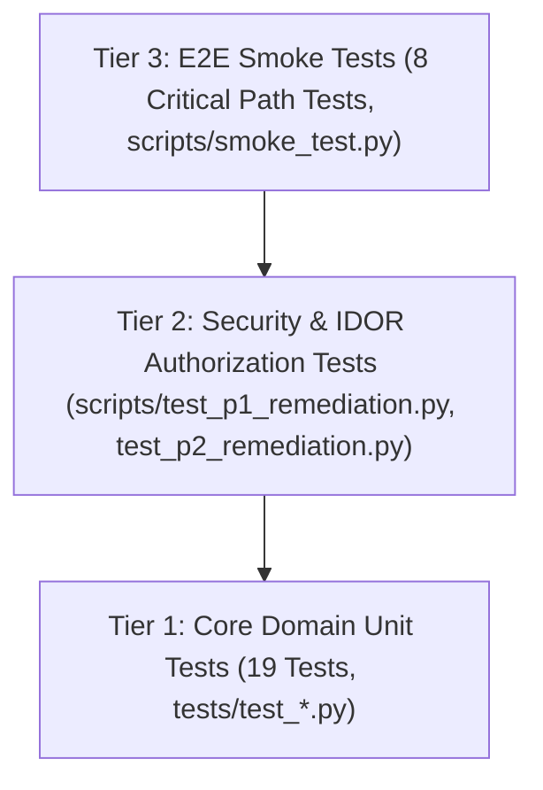

# Layer 8: Testing Strategy & Automated Test Suite

## 1. Executive Summary

Code Captain implements a strict, multi-tier testing pyramid to guarantee execution accuracy, deterministic scoring, security authorization boundaries, and client UI stability.



---

## 2. Test Pyramid & Directory Structure

```text
tests/
├── __init__.py               # Package marker
├── test_auth.py              # Password hashing, Argon2 verification, JWT encoding/decoding, OAuth CSRF state
├── test_verdicts.py          # Judge verdict transitions (AC, WA, TLE, MLE, RE), ICPC contest score penalties
├── test_submissions.py       # Submission schemas, language enums, IDOR access guard, idempotency keys
└── test_problems.py          # Problem models, difficulty enums, semantic search requests, soft deletion
```

### Coverage by Component

| Test Suite | File | Test Count | Key Invariants Asserted |
| :--- | :--- | :--- | :--- |
| **Authentication & Tokens** | `tests/test_auth.py` | 6 | Argon2 password hashing, JWT sub/role claims, refresh token validity, OAuth signed state CSRF |
| **Judge Verdict Engine** | `tests/test_verdicts.py` | 6 | Time limit threshold (TLE), memory threshold (MLE), exit code (RE), output diff (WA/AC), ICPC penalty calculation |
| **Submissions & IDOR** | `tests/test_submissions.py` | 4 | LanguageEnum validation, contestant submission IDOR protection, admin cross-tenant visibility, Redis idempotency keys |
| **Problems & Semantic Discovery**| `tests/test_problems.py` | 3 | ProblemDifficulty schema validation, SemanticSearchRequest non-empty query enforcement, soft delete timestamp |

---

## 3. Running Tests Locally

### A. Run Core Unit Tests
```bash
# Set PYTHONPATH to project root
export PYTHONPATH="."   # On Linux/macOS
$env:PYTHONPATH="."     # On Windows PowerShell

# Run entire test suite
python -m unittest discover tests -v
```

### B. Run Security Remediation Suite
```bash
python scripts/test_p1_remediation.py
python scripts/test_p2_remediation.py
```

### C. Run Critical-Path Production Smoke Tests
```bash
python scripts/smoke_test.py
```

---

## 4. Continuous Integration Integration

The test suite runs automatically on every pull request and push to `main` via [.github/workflows/ci.yml](.github/workflows/ci.yml). Any failing assertion blocks the merge gate and halts deployment.
